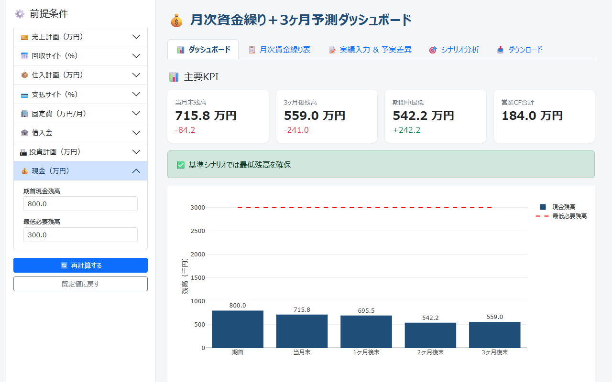
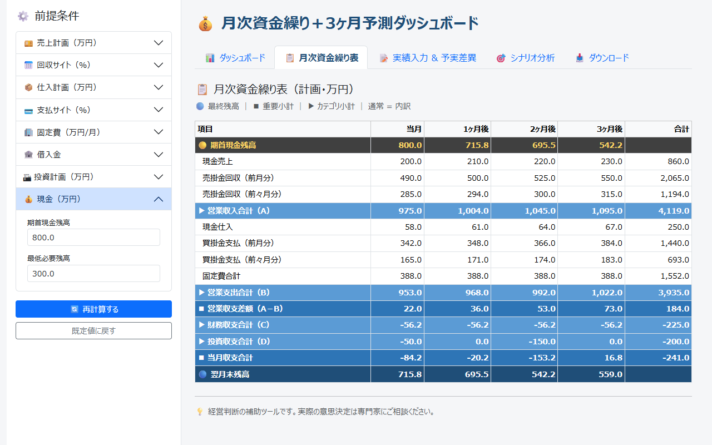
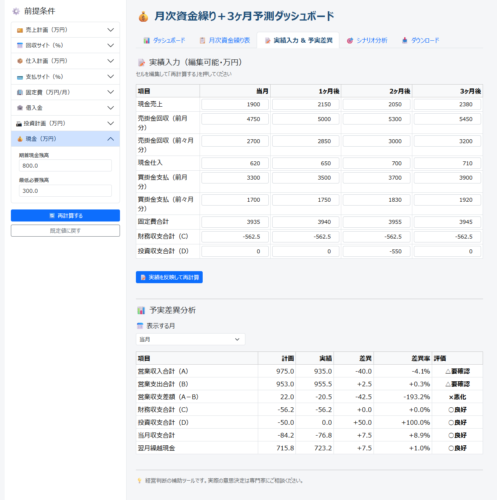
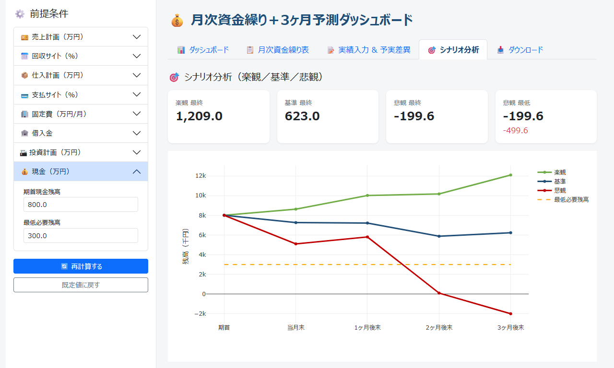

# 月次資金繰り＋3ヶ月予測ダッシュボード（Cashflow Dashboard）

売上・仕入の回収／支払サイト、固定費、借入、設備投資などの前提条件から、月次資金繰り表と 3 ヶ月先までの現金残高を計算し、楽観・基準・悲観のシナリオ比較と予実差異の評価までブラウザで行える Django アプリです。中小企業の資金繰り管理やその学習を想定しており、計画表と実績表は Excel に出力できます。


> **English summary:** A Django dashboard for monthly cash-flow planning, aimed at small businesses and learners. From assumptions such as collection/payment terms, fixed costs, loans and capital expenditure, it builds a monthly cash-flow table with a 3-month balance forecast, compares optimistic/base/pessimistic scenarios, evaluates budget-vs-actual variances, and exports the tables to Excel. It is a Django port of an earlier Streamlit app and keeps all state in file-based sessions, so no database is needed.

<p align="center">
  
</p>

## 目次

- [主な機能](#主な機能)
- [クイックスタート](#クイックスタート)
- [使い方](#使い方)
- [技術スタック](#技術スタック)
- [プロジェクト構成](#プロジェクト構成)
- [設計のポイント](#設計のポイント)
- [テスト](#テスト)
- [本番環境で使うとき](#本番環境で使うとき)
- [既知の制限](#既知の制限)
- [データと免責](#データと免責)

## 主な機能

- **月次資金繰り表**：当月〜3ヶ月後の 4 ヶ月分を、営業収支（A−B）・財務収支（C）・投資収支（D）に分けて計算します。売上と仕入は「当月現金・翌月・翌々月」の比率で入金・支払に振り分けます。
- **主要 KPI とアラート**：当月末残高、3ヶ月後残高、期間中の最低残高、営業 CF 合計を表示し、最低必要残高を下回る月があると警告します。
- **予実差異分析**：実績を入力して再計算すると、選んだ月について計画・実績・差異・差異率と評価（○良好／△要確認／×悪化）を表示します。
- **シナリオ分析**：楽観・基準・悲観の 3 シナリオで月末残高を比べ、悲観シナリオで不足する金額と推奨アクションを示します。
- **Excel 出力**：計画表と実績入力表を、2 シートの .xlsx ファイル（openpyxl で生成）としてダウンロードできます。
- **データベース不要**：入力内容はファイルベースのセッションに保存するため、`migrate` などの準備は要りません。

## クイックスタート

前提：

- Python 3.13 で動作確認しています（`requirements.txt` の `Django>=5.0` は Python 3.10 以上が必要です）。
- 画面の Bootstrap と Plotly.js は CDN から読み込むため、ブラウザからインターネットに接続できる必要があります。

### Windows（PowerShell）

```powershell
git clone https://github.com/rebelnaoto7/cashflow_app.git
cd cashflow_app
python -m venv .venv
.\.venv\Scripts\Activate.ps1
pip install -r requirements.txt
python manage.py runserver
```

`Activate.ps1` の実行がブロックされた場合は、`Set-ExecutionPolicy -Scope Process -ExecutionPolicy RemoteSigned` を実行してから、もう一度有効化してください（今開いている PowerShell だけに適用されます）。

### macOS / Linux

```bash
git clone https://github.com/rebelnaoto7/cashflow_app.git
cd cashflow_app
python3 -m venv .venv
source .venv/bin/activate
pip install -r requirements.txt
python manage.py runserver
```

起動したら、ブラウザで <http://127.0.0.1:8000/> を開きます。サンプルの前提条件で計算したダッシュボードが表示されます。ポート 8000 が使用中のときは、`python manage.py runserver 8001` のようにポート番号を指定してください。

> [!NOTE]
> `python manage.py migrate` は不要です。このアプリは `DATABASES = {}`（データベースなし）で動くため、`migrate` を実行すると `settings.DATABASES is improperly configured` というエラーで終了します。

## 使い方

### 1. 前提条件を入力して再計算する

左側の「前提条件」に値を入れて「再計算する」を押すと、全タブが計算し直されます。「既定値に戻す」を押すとサンプル値に戻ります。

| グループ | 入力項目 | 単位 |
| --- | --- | --- |
| 売上計画 | 前々月〜3ヶ月後（6 ヶ月分）の売上 | 万円 |
| 回収サイト | 当月現金売上・翌月入金・翌々月入金の比率 | 0〜1 の小数 |
| 仕入計画 | 前々月〜3ヶ月後（6 ヶ月分）の仕入 | 万円 |
| 支払サイト | 当月現金仕入・翌月支払・翌々月支払の比率 | 0〜1 の小数 |
| 固定費 | 人件費・家賃・水道光熱費・通信費・その他経費・税金支払 | 万円/月 |
| 借入金 | 借入金残高・年利率・月次返済・月次新規借入 | 万円（年利率は小数） |
| 投資計画 | 前々月〜3ヶ月後（6 ヶ月分）の設備投資 | 万円 |
| 現金 | 期首現金残高・最低必要残高 | 万円 |

- 前々月と前月の売上・仕入は、当月以降の売掛金回収・買掛金支払の計算に使います。投資計画の前々月・前月の欄は入力できますが、計算には使われません。
- 比率は `0.2`（= 20%）のように小数で入力します。グループ名は「％」表記ですが、入力は 0〜1 です。3 つの比率の合計が 1 になっているかはチェックしないため、入力時に確認してください。

### 2. タブで結果を確認する

| タブ | 内容 |
| --- | --- |
| ダッシュボード | 主要 KPI 4 種と残高アラート、現金残高推移、月次キャッシュフロー構成（営業・財務・投資 CF と月末残高） |
| 月次資金繰り表 | 計画ベースの資金繰り表（万円）。最終残高・重要小計・カテゴリ小計を色分けして表示 |
| 実績入力 & 予実差異 | 実績を表に入力して「実績を反映して再計算」。「表示する月」を選ぶと、その月の予実差異を表示 |
| シナリオ分析 | 楽観・基準・悲観の残高推移（カード・グラフ・表）と、不足見込みの判定・推奨アクション |
| ダウンロード | 計画表と実績入力表を Excel でダウンロード |

<p align="center">
  
</p>

サンプル値では、計画上の期間中の最低残高は 542.2 万円（2ヶ月後末）で、最低必要残高の 300 万円を上回ります。

#### 予実差異の評価基準

差異率は「（実績 − 計画）÷ 計画の絶対値」です（計画が 0 の項目は差異率 0% として扱います）。

| 項目の種類 | ○良好 | △要確認 | ×悪化 |
| --- | --- | --- | --- |
| 収入・収支・残高（営業収入合計など 6 項目） | 0% 以上 | −10% より大きく 0% 未満 | −10% 以下 |
| 支出（営業支出合計） | 0% 以下 | 0% より大きく +10% 未満 | +10% 以上 |

<p align="center">
  
</p>

#### シナリオの前提

| シナリオ | 売上 | 仕入 | 固定費 | 追加の想定 |
| --- | --- | --- | --- | --- |
| 楽観 | ×1.10 | ×0.95 | ×0.98 | なし |
| 基準 | ×1.00 | ×1.00 | ×1.00 | なし |
| 悲観 | ×0.85 | ×1.08 | ×1.05 | 2ヶ月後に一時的な損失 200 万円、1ヶ月後に新規借入 300 万円 |

シナリオ分析は、各月の売上・仕入をその月に全額入金・支払する簡易モデルです。回収・支払サイトと「月次新規借入」の入力は使わないため、「基準」シナリオの残高は月次資金繰り表の残高と一致しません（サンプル値の 3ヶ月後残高は、資金繰り表が 559.0 万円、基準シナリオが 623.0 万円）。サンプル値の悲観シナリオでは 3ヶ月後末の残高が −199.6 万円となり、「悲観で 499.6万円 不足見込み」と表示されます。

<p align="center">
  
</p>

### 3. Excel に出力する

「ダウンロード」タブのボタン（URL は `/download/excel/`）から、`資金繰り_YYYYMMDD_HHMM.xlsx` という名前のファイルをダウンロードできます。

| シート | 内容 |
| --- | --- |
| 月次資金繰り表 | 計画表（前月繰越現金〜翌月繰越現金の 15 項目 × 当月〜3ヶ月後・合計） |
| 実績入力 | 実績入力表（9 項目 × 当月〜3ヶ月後） |

Excel の数値は千円単位で、書式や単位の表記は付きません。

### 金額の単位

- 前提条件の入力と、KPI・月次資金繰り表・予実差異表・シナリオのカードと表は **万円** で表示します。
- 内部の計算は **千円** で行います（入力した万円の値を 10 倍して保存します）。実績入力表、Excel、「月次キャッシュフロー構成」と「シナリオ分析」のグラフも千円です。
- 一部の表示で単位の表記が食い違っています。詳しくは[既知の制限](#既知の制限)を参照してください。

## 技術スタック

| 分類 | 使用技術 |
| --- | --- |
| 言語・フレームワーク | Python 3.13、Django（`requirements.txt` は `>=5.0`。動作確認は 6.1.2） |
| 計算 | pandas、NumPy |
| Excel 出力 | openpyxl |
| 画面 | Django テンプレート、Bootstrap 5.3.3（CDN） |
| グラフ | Plotly.js 2.35.2（CDN） |
| 状態の保存 | Django のファイルベースセッション（データベースなし） |

## プロジェクト構成

```text
cashflow_app/
├── manage.py
├── requirements.txt
├── README.md
├── cashflow_project/            # プロジェクト設定
│   ├── __init__.py
│   ├── settings.py              # セッション・タイムゾーンなどの設定
│   ├── urls.py
│   ├── asgi.py
│   └── wsgi.py
├── dashboard/                   # アプリ本体
│   ├── __init__.py
│   ├── apps.py
│   ├── constants.py             # 既定値・月のラベル・表示用の行名
│   ├── forms.py                 # 前提条件フォーム（万円 → 千円の変換）
│   ├── services.py              # 計算ロジックと Excel 生成（Django に依存しない）
│   ├── views.py                 # 画面・グラフ定義・Excel ダウンロード
│   ├── urls.py
│   ├── migrations/
│   │   └── __init__.py
│   └── templates/dashboard/
│       ├── base.html            # 共通レイアウト（CDN の読み込み・CSS）
│       └── index.html           # 5 タブの画面
└── docs/
    ├── DEVELOPMENT.md           # 開発者向けメモ（移植対応表・計算式）
    └── images/                  # README 用のスクリーンショット
```

| URL | 内容 |
| --- | --- |
| `/` | ダッシュボード（GET で表示、POST で再計算） |
| `/reset/` | セッションの入力内容を消して既定値に戻し、`/` へリダイレクト |
| `/download/excel/` | Excel ファイルのダウンロード |

移植元の Streamlit 版（`app.py`）は、このリポジトリには含まれていません。

## 設計のポイント

- **計算ロジックを Django から分離**：`dashboard/services.py` は pandas と NumPy だけで書いた関数（計画・実績・シナリオ・差異評価・Excel 生成）で、Django に依存しません。Streamlit 版の関数を移植したものです。
- **1 つのフォームで全タブを再計算**：前提条件・実績入力・表示月を 1 つのフォームで POST し、そのたびに全タブを計算し直します。入力のたびにスクリプト全体を実行し直す Streamlit の動きを、Django で再現した形です。
- **状態はセッションに保存**：前提条件と実績はセッション（キー `cf_state` と `cf_actual`）に保存します。`SESSION_ENGINE` はファイルベースで、保存先は既定では OS の一時フォルダです。
- **グラフの定義はサーバー側で作成**：Plotly の図（data と layout）をビューで dict として組み立て、JSON にしてテンプレートに埋め込み、ブラウザの Plotly.js で描画します。Python 側に plotly パッケージは要りません。
- **単位の変換はフォームに集約**：`AssumptionsForm` が万円の入力を千円に変換し（`to_state`）、入力欄に表示するときは千円から万円に戻します（`initial_from_state`）。

Streamlit 版との対応表と計算式の詳細は、[docs/DEVELOPMENT.md](docs/DEVELOPMENT.md) にまとめています。

## テスト

自動テストはまだありません（`python manage.py test` の結果は `Ran 0 tests` / `NO TESTS RAN`）。公開前の確認として、次のことを実際に行いました。

```powershell
python manage.py check           # System check identified no issues (0 silenced).
python manage.py check --deploy  # 本番向け設定の警告が 6 件（「本番環境で使うとき」を参照）
```

- HTTP での確認：`/` が 200、`/reset/` が 302（`/` へリダイレクトし、既定値に戻る）、`/download/excel/` が 200 で .xlsx を返すこと。CSRF トークンのない POST は 403 になること。
- ダウンロードした Excel を openpyxl で開き、シート「月次資金繰り表」「実績入力」があり、数値（千円）が画面の計算結果（万円）と一致すること。
- ブラウザでの操作：前提条件の変更と再計算、実績入力と表示月の切り替え、5 タブの表示、3 つのグラフの描画、Excel のダウンロード。
- 入力欄を空にして送信すると「このフィールドは必須です。」と表示され、前提条件は前の値のまま残ること。

動作確認環境：Windows 11 / Python 3.13 / Django 6.1.2 / pandas 3.1.0 / NumPy 2.5.4 / openpyxl 3.1.5 / Microsoft Edge（2026年11月）。macOS / Linux のコマンドは標準的な手順を記載しており、実機では確認していません。

## 本番環境で使うとき

このリポジトリの設定は開発用です。`cashflow_project/settings.py` は `TIME_ZONE` 以外の値を環境変数から読まないため、公開する前に設定ファイルを書き換えてください。

| 設定 | 現在の値 | 公開時の対応 |
| --- | --- | --- |
| `SECRET_KEY` | 開発用の固定値 | 環境変数などから読み込む形に変え、推測できない値にする |
| `DEBUG` | `True` | `False` にする |
| `ALLOWED_HOSTS` | `['*']` | 公開するドメインだけに絞る |
| セッションの保存先 | OS の一時フォルダ（`SESSION_FILE_PATH` は未設定） | 専用のフォルダを `SESSION_FILE_PATH` で指定する |
| `TIME_ZONE` | 環境変数 `TIME_ZONE`。未設定なら `Asia/Tokyo` | 必要なら環境変数で指定する |

- `python manage.py check --deploy` では、HTTPS 関連（`SECURE_HSTS_SECONDS`・`SECURE_SSL_REDIRECT`・`SESSION_COOKIE_SECURE`・`CSRF_COOKIE_SECURE`）と `SECRET_KEY`・`DEBUG` について、合計 6 件の警告が出ます。
- セッションファイルは自動では消えません。期限切れのファイルは `python manage.py clearsessions` で削除できます。
- CSS と JavaScript はすべて CDN から読み込むため、`collectstatic` は不要です。
- `runserver` は開発用のサーバーです。公開する場合は WSGI サーバー（エントリーポイントは `cashflow_project/wsgi.py`）を使ってください。

## 既知の制限

- ダッシュボードの「現金残高推移」グラフで単位が混在しています。棒と数値ラベルは万円ですが、縦軸の表記は「千円」で、最低必要残高の線は千円の値で描かれます。そのためサンプル値では、300 万円の線が「3000」の位置に引かれ、残高の棒より上に表示されます（棒の色分けと KPI の判定は正しく計算されます）。
- 「実績入力」の表は、見出しに「万円」とありますが、値は千円単位です（例：現金売上の 1900 は 190 万円）。
- 予実差異表の評価セル（○・△・×）には背景色の CSS がありますが、Bootstrap 5.3 の表のスタイルに上書きされ、色が付きません。
- フォームを送信（再計算・表示月の切り替え）すると、画面は常に「ダッシュボード」タブに戻ります。また送信後にブラウザで再読み込みすると、フォームが再送信されます。
- 一度再計算したあとは、設備投資が 0 の月の投資収支合計（D）が「-0.0」と表示されます。
- 入力値の範囲（比率の 0〜1 など）はブラウザの入力欄でのみ制限しており、サーバー側では確認していません。
- シナリオ分析は簡易モデルです（[シナリオの前提](#シナリオの前提)を参照）。
- 自動テストはまだありません。

## データと免責

- 前提条件の既定値（売上・仕入・固定費・借入など）と実績入力表の初期値は、操作を試すためのサンプル値です。
- このアプリは資金繰りの検討を補助するためのもので、計算結果の正確性や特定の目的への適合性は保証しません。実際の経営判断は、専門家に相談したうえで行ってください。
